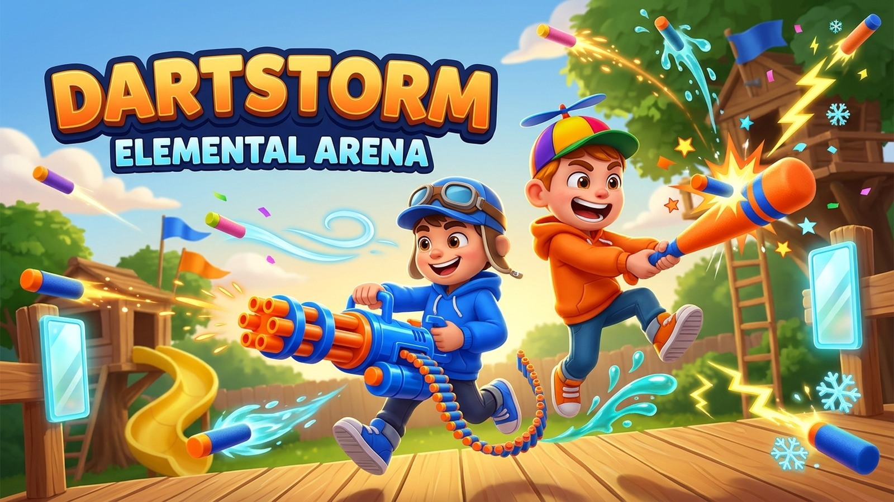
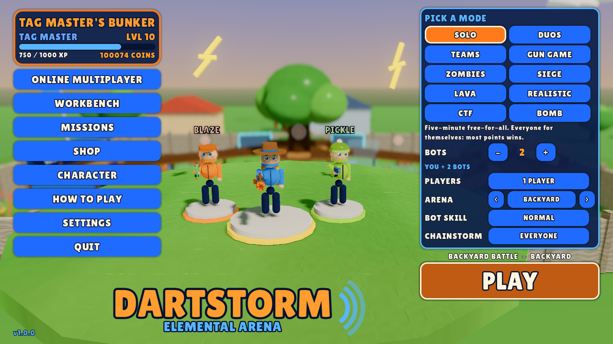
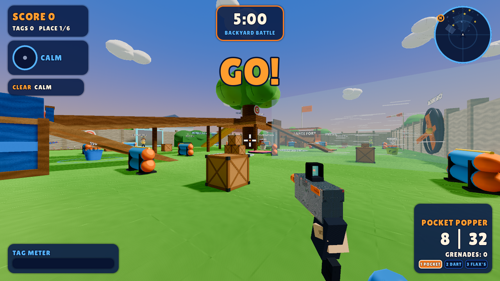
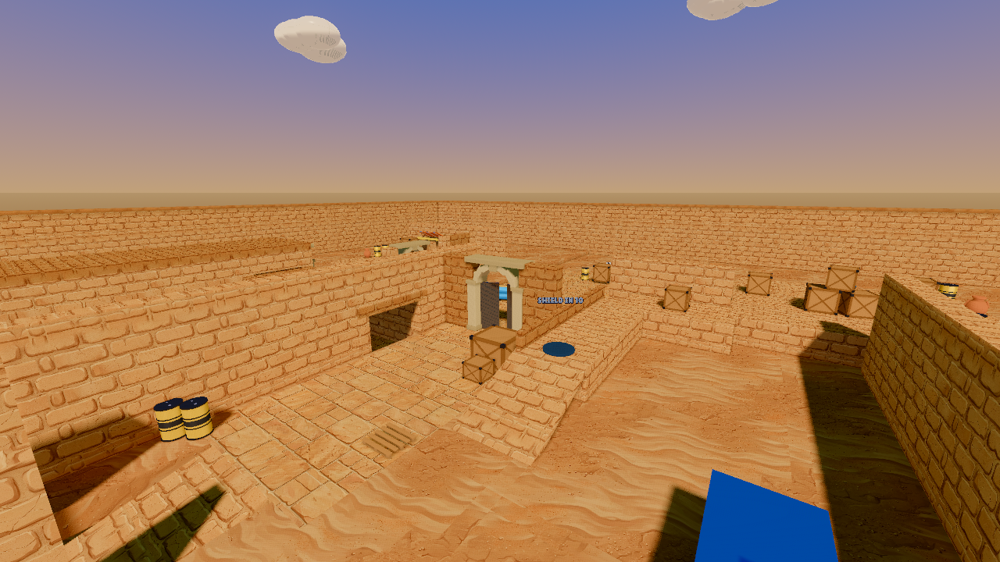
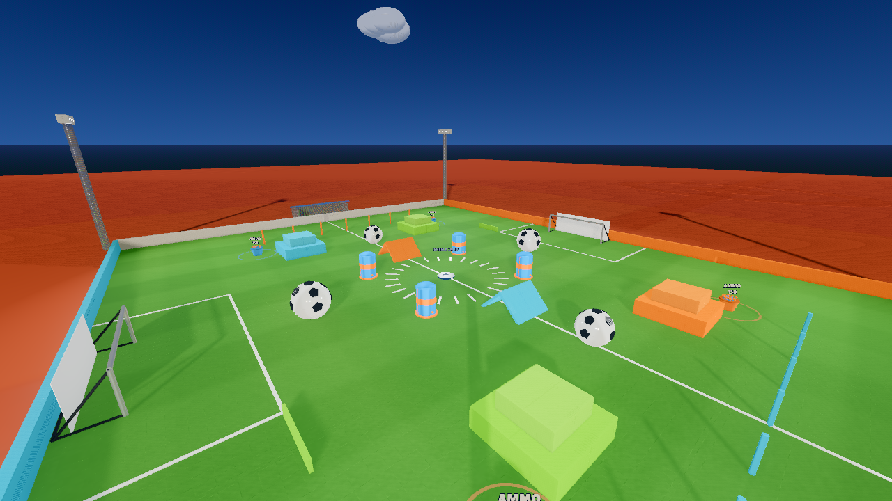

<p align="center">
  
</p>

<h1 align="center">DARTSTORM: Elemental Arena</h1>

<p align="center">
  <strong>A colourful, 100% kid-safe, first-person foam-dart arena shooter built with Godot 4.4</strong><br/>
  9 Handcrafted Arenas · 10 Game Modes · 12 Blasters &amp; Foam Bat · 2-Player Split-Screen · LAN &amp; Online Multiplayer
</p>

<p align="center">
  <a href="https://github.com/flaxos/dartstorm/releases/latest"></a>
  
  
  
</p>

---

Blue team versus orange team, backyard forts, buckets of foam darts, wind that bends your shots, mirrors you can bounce darts off, elemental reactions (Wind, Fire, Water, Lightning, Ice), a **Foam Bat** that bats incoming darts straight back at rivals, and **FLAX'S CHAINSTORM**: a ridiculous belt-fed, six-barrel foam cannon.

No gore and no real-world guns. Tagged players pop into a shower of foam confetti and respawn. Zero pay-to-win, zero microtransactions, and 100% kid-safe.

---

## Downloads (GitHub Releases — No Godot Required)

Grab ready-to-play standalone packages from the **[v1.0.0 GitHub Release](https://github.com/flaxos/dartstorm/releases/tag/v1.0.0)**:

| Platform | Package | How to Play |
|---|---|---|
| **Windows (64-bit)** | [`DARTSTORM-1.0.0-windows-x86_64.zip`](https://github.com/flaxos/dartstorm/releases/download/v1.0.0/DARTSTORM-1.0.0-windows-x86_64.zip) | Extract the zip and double-click `DARTSTORM.exe` (single self-contained executable) |
| **Linux (64-bit)** | [`DARTSTORM-1.0.0-linux-x86_64.tar.gz`](https://github.com/flaxos/dartstorm/releases/download/v1.0.0/DARTSTORM-1.0.0-linux-x86_64.tar.gz) | Extract and double-click `DARTSTORM.x86_64`, or run `./install-shortcut.sh` to add to your app menu |
| **Android (ARM64)** | [`DARTSTORM-1.0.0-android.apk`](https://github.com/flaxos/dartstorm/releases/download/v1.0.0/DARTSTORM-1.0.0-android.apk) | Sideload `DARTSTORM-1.0.0-android.apk` onto any Android phone/tablet (includes touch controls + gamepad support) |
| **Web (HTML5 / WASM)** | [`DARTSTORM-1.0.0-web.zip`](https://github.com/flaxos/dartstorm/releases/download/v1.0.0/DARTSTORM-1.0.0-web.zip) | Serve from any static HTTP server (`python3 -m http.server`) and open in Chrome, Firefox, Edge, or Safari |
| **Dedicated Server (Linux)** | [`DARTSTORM-1.0.0-server-linux-x86_64.tar.gz`](https://github.com/flaxos/dartstorm/releases/download/v1.0.0/DARTSTORM-1.0.0-server-linux-x86_64.tar.gz) | Extract and run `./start_server.sh` to host LAN/online matches with auto-discovery and map rotation |

Checksums for every release file are published in [`SHA256SUMS.txt`](https://github.com/flaxos/dartstorm/releases/download/v1.0.0/SHA256SUMS.txt).

---

## Screenshots

| 3D Squad Bunker Lobby | Backyard Fortress Action & Tactical Radar |
|---|---|
|  |  |
| **Duststorm II (Stylized Desert Arena)** | **Floodlit Twilight Soccer Stadium** |
|  |  |

---

## Building & Running From Source

### Run in Godot 4.4+
1. Download **Godot 4.4.1+** (Standard build, not .NET) from <https://godotengine.org/download>.
2. Open Godot, click **Import**, select `project.godot`, and click **Import & Edit**.
3. Press **F5** (or click Play).

### Terminal Quick Launch & Export Scripts
```bash
./tools/run.sh               # Launch the game (Main Menu)
./tools/run.sh editor        # Open in the Godot Editor
./tools/run.sh demo          # Watch an automated 20-second gameplay demo

./tools/export_windows.sh    # Build Windows 64-bit DARTSTORM.exe + .zip
./tools/export_linux.sh      # Build Linux 64-bit DARTSTORM.x86_64 + .tar.gz
./tools/export_apk.sh        # Build signed Android ARM64 APK
./tools/export_web.sh        # Build HTML5 / WebAssembly browser bundle
./tools/export_server.sh     # Build Linux Headless Dedicated Server
./tools/export_all.sh        # Build ALL platforms + SHA256SUMS.txt into build/release-v1.0.0/
```

> *Exporting requires Godot's matching export templates (`Editor > Manage Export Templates` once in Godot).*

---

## Controls

Fully playable with **Keyboard & Mouse**, any **Gamepad** (Xbox, PlayStation, Switch Pro, generic — plug-and-play with aim assist and rumble), or **Mobile Touch Controls** (virtual thumbstick + swipe look + arcade buttons). Every gameplay action can be remapped in **Settings > Custom Controls**.

| Action | Keyboard / Mouse | Gamepad / Controller |
|---|---|---|
| **Move** | W A S D / Arrow keys | Left Stick |
| **Look / Aim** | Mouse | Right Stick (curved response + aim assist) |
| **Jump** | Space | A / Cross |
| **Sprint** | Shift (while moving forward) | Click Left Stick (L3) |
| **Aim Down Sights (ADS)** | Right Mouse Button | Left Trigger (LT / L2) |
| **Fire Blaster / Swing Foam Bat** | Left Mouse Button | Right Trigger (RT / R2) |
| **Zombie Claw Swipe** | Left Mouse Button (when Zombie) | Right Trigger (RT / R2) |
| **Foam Grenade** | G / Middle Mouse | D-Pad Down |
| **Interact (Plant / Defuse / Repair)** | F / E | D-Pad Right |
| **Reload** | R | X / Square |
| **Squad Ping** | T | D-Pad Up |
| **Switch Blaster / Foam Bat** | `1`–`5`, Scroll Wheel, Q / E | Y / Triangle, LB, RB |
| **Scoreboard** | Tab (hold) | Back / View / Share |
| **Pause Game** | Esc or P | Start / Menu / Options |
| **Menu Select / Back** | Mouse, Arrows + Enter / Esc | D-Pad / Stick, A Select, B Back |

---

## Arsenal (11 Foam Blasters + Foam Bat Melee)

| Weapon | Style / Element | Role |
|---|---|---|
| **Pocket Popper** | Semi-Auto Pistol | Crisp, accurate all-round starter |
| **Double Trouble** | Twin-Shot Pistol | Fires 2 foam darts per pull |
| **Dart Sprayer** | Full-Auto SMG | 30-dart drum for fast close-mid pressure |
| **Wind Whisperer** | Wind Rifle | High-velocity gusts with playful micro-lift |
| **Foam Hammer** | Pump Shotgun | 8-slug close-range foam wallop |
| **Hydro Soaker** | Water Cannon | Heavy splash knockback; cools lava into obsidian & primes shock combos |
| **Ricochet Ranger** | Bouncy Revolver | Bounces up to 4 times off any surface for trick-shot bonuses |
| **Thunder Cannon** | Lightning Blaster | Chain-zaps nearby rivals and electrifies water puddles |
| **Frost Ranger** | Ice Rifle | Chills rivals and freezes lava tides into obsidian stepping stones |
| **Longshot** | Precision Sniper | 35° FOV ADS scope, flat 78 m/s Mega Darts (85 tag power) |
| **Flax's Chainstorm** | Six-Barrel Rotary | 30 darts/s belt-fed signature foam cannon (no reload!) |
| **Foam Bat** | Melee Slugger | +14% sprint speed, wide 3.0m cartoon knockback bonk, **bats incoming enemy darts & grenades straight back**! Final winning rung in Gun Game, Slot `5` in Zombies/Siege, arena pickup (`BatPickup`) in all other modes |

---

## Game Modes (10 Modes)

Play **Solo vs Bots**, **2-Player Couch Split-Screen** (KBM + Gamepad or Dual Gamepads), or **LAN / Online Multiplayer**:

1. **SOLO (Backyard Battle):** Fast-paced 5-minute free-for-all against 2–7 bots.
2. **GUN GAME:** 11-rung elemental blaster ladder — advance with every tag past Flax's Chainstorm and land the final **Foam Bat** bonk to win!
3. **DUOS:** Partner with a bot buddy (or Player 2 in split-screen) with adjacent buddy spawning and contextual 3D squad pings.
4. **TEAMS (Blue vs Orange):** Up to 4 v 4 team battles with home-base respawns, team score chips, colorblind-safe palettes, and team podiums.
5. **ZOMBIES:** Asymmetrical infection tag. 1 Alpha Zombie hunts survivors armed with blasters and a Foam Bat; tagged survivors join the horde.
6. **ZOMBIE SIEGE (Base Defense):** Co-op 5-wave base defense protecting the **Base Core** and 4 repairable **Barricades** against Runners, Brutes, and the **Mega Foam Titan Boss**.
7. **FLOOR IS LAVA:** Dynamic molten-foam tides flood the floor; cool lava with Water or Ice darts to create solid obsidian stepping stones.
8. **REALISTIC:** High-stakes tactical tagging with lowered tag thresholds and streamlined HUD.
9. **CAPTURE THE FLAG (CTF):** Grab the rival team's flag from its anchored base pedestal and return it home while defending your own.
10. **PLANT THE BOMB:** Round-based Attackers vs Defenders objective mode at explicit Site A & Site B zones with arming, defusing, and tactical callouts.

---

## Arenas (9 Stylized Arenas)

Switch live between all 9 arenas in the 3D lobby (each with bespoke Forward+ AgX atmospheric lighting & clean Compatibility fallback):

- **Backyard Fortress:** Classic fort-vs-fort yard with walkways, trampolines, Mirror Alley, Windy Way, barking dog house, and paddling pool.
- **Home Turf:** Toy-scale family home with furnished rooms, bouncy beds, kitchen wind fan, and climbable patio roof ramp.
- **Tempest Treehouse:** Multi-tier ancient canopy grove with suspension rope bridge, jump-pads, ice slide chute, and high Crow's Nest.
- **Playground:** Bright park playground with climbing towers, slides, sandpits, and fast vertical sightlines.
- **Sunny Park:** Sunlit open park with bandstand pavilion, pond bridges, gazebo cover, and winding paths.
- **Soccer Stadium:** Floodlit twilight stadium with pitch cover, oversized soccer balls, and golden-cyan night lighting.
- **Two Fortresses:** Dual-fort valley linked by a covered wooden bridge over an open moat, navigable basement vaults, water tunnels, and sniper battlements.
- **Dusty Courtyard:** Sun-baked sandstone desert courtyard with sunken underpass, sniper bridge, open central arch, and Sites A & B.
- **Duststorm II:** Stylized desert tactical arena with Long A, Pit ramp, Mid/Lower B Tunnel, Catwalk, and Sites A & B.

---

## HUD, Workbench, Progression & Multiplayer

- **Tactical Radar / Minimap:** Rotating circular top-right radar tracking cover, FOV cone, teammates, firing/nearby rivals, Bomb Sites A/B, CTF flags, Base Core, Foam Bat pickups, and ammo buckets — paired with directional damage arcs, dynamic hitmarkers, and zero-emoji `Lilita One` typography.
- **Garage Workbench & Weapon Mastery:** Earn Weapon XP to unlock optics, barrels, springs, magazines, grips, and stocks for 7 modular blasters in the enclosed 3D Garage Workbench.
- **Leveling, Missions & 100% Kid-Safe Coin Shop:** Earn XP and Coins purely through play. Unlock 11 hats, jersey/dart colors, and 8 seamless triplanar blaster skins across multiple PBR finishes. Zero real money, zero microtransactions.
- **LAN, Online & Dedicated Server:** Host or join matches via WebSocket multiplayer with automatic UDP LAN discovery (`port 8925`), or run a headless Linux dedicated server via `./tools/run_server.sh` / `./tools/export_server.sh`.

---

## For Developers

- `./tools/validate.sh`: Imports the project, compiles all 106 scripts with warnings treated as errors, boots the main menu and match headless, runs all **1,544+ automated unit & integration tests**, and verifies zero leaked objects at exit (`--quick` skips the test suite).
- `./tools/dart_table.gd`: Generates the ballistic flight table from live `DartProjectile` physics (`godot --headless --path . -s res://tools/dart_table.gd`).
- `./tools/generate_skins.py` / `generate_pbr_textures.py` / `generate_arena_pbr_textures.py`: Procedural 2D seamless pattern & PBR texture generators.

### Documentation Map

Start with [`CLAUDE.md`](CLAUDE.md) for codebase conventions, or browse [`docs/`](docs/):

| Document | Purpose |
|---|---|
| [CHANGELOG.md](CHANGELOG.md) | Release history from v0.1.0 through v1.0.0 |
| [docs/GDD.md](docs/GDD.md) | **Authoritative Game Design Document**: mechanics, weapons, arenas, modes, and feature specs |
| [docs/CONCEPT_BRIEF.md](docs/CONCEPT_BRIEF.md) | Original concept brief and young players' vision, archived verbatim |
| [docs/ARCHITECTURE.md](docs/ARCHITECTURE.md) | Systems architecture, data ownership, safeguards, and performance budgets |
| [docs/TUNING.md](docs/TUNING.md) | No-code Inspector tuning guide for blasters, darts, melee, bots, and game modes |
| [docs/ROADMAP.md](docs/ROADMAP.md) | Release milestones, current status, and completed history |
| [docs/DECISIONS.md](docs/DECISIONS.md) | Architectural decision records (`D-001` through `D-049`) |
| [docs/UAT.md](docs/UAT.md) | Repeatable User Acceptance Testing script and results log |
| [assets/README.md](assets/README.md) | Asset provenance, hybrid 3D/procedural pipeline, branding art, and open-source licenses |
| [assets/models/README.md](assets/models/README.md) | 3D `.glb` model rigging, socket, material-slot, and polycount specification |

All game code, 3D assets, shaders, PBR textures, cover art, sounds, and music are original to DARTSTORM. The sole third-party asset is the open-source **Lilita One** display font (SIL Open Font License 1.1; see [`assets/fonts/OFL.txt`](assets/fonts/OFL.txt) and [`assets/README.md`](assets/README.md)).
